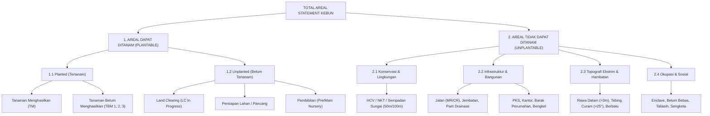

# CATATAN KHUSUS MASTER DATA, KARTOGRAFI CETAK PETA & PEDOMAN TEKNIS GIS

**Dokumen Sintesis Master Data, Hirarki Areal Statement, Desain Blok Ideal, SOP Land Clearing, Standar Cetak Peta A4, Kodefikasi Resmi & Database Operasional**  
*PT Bangkitgiat Usaha Mandiri (PT BUM) / Holding Sawit GIS Department*  
*Status: Dokumen Resmi Panduan Teknis & Logika Sistem WebGIS & Dashboard*

---

## DAFTAR ISI

1. [Ringkasan Eksekutif & Struktur Hierarki Kebun](#1-ringkasan-eksekutif--struktur-hierarki-kebun)
2. [Tabel Referensi Resmi Region, Afdeling & Holding](#2-tabel-referensi-resmi-region-afdeling--holding)
3. [Standar Kodefikasi Pekerjaan, Jenis Peta & Personel GIS](#3-standar-kodefikasi-pekerjaan-jenis-peta--personel-gis)
4. [Katalog & Kamus Data Master Data Spasial (`Master Data`)](#4-katalog--kamus-data-master-data-spasial-master-data)
5. [Standar Hirarki Areal Statement (`FORM 001/FORM/GIS-JKO/III/2024`)](#5-standar-hirarki-areal-statement-form-001formgis-jkoiii2024)
6. [Standar Rancang Bangun Blok Ideal 25 Ha (`Blok Ideal New Layout`)](#6-standar-rancang-bangun-blok-ideal-25-ha-blok-ideal-new-layout)
7. [Pedoman Teknis & SOP GIS Land Clearing (`SOP GIS LC` & `Draft SOP LC`)](#7-pedoman-teknis--sop-gis-land-clearing-sop-gis-lc--draft-sop-lc)
8. [Standar Kartografi & Layout Cetak Peta A4 Resmi (`Contoh Standart Cetak Peta` & `StandartCetakPeta`)](#8-standar-kartografi--layout-cetak-peta-a4-resmi-contoh-standart-cetak-peta--standartcetakpeta)
9. [Struktur Database & Validasi Topologi Operasional R1-R2 (`Operasional`)](#9-struktur-database--validasi-topologi-operasional-r1-r2-operasional)
10. [Arsitektur Integrasi & Logika Bisnis untuk Pengembangan WebGIS](#10-arsitektur-integrasi--logika-bisnis-untuk-pengembangan-webgis)

---

## 1. RINGKASAN EKSEKUTIF & STRUKTUR HIERARKI KEBUN

Dokumen ini disusun sebagai **landasan arsitektur data tunggal (single source of truth)** bagi seluruh pengembang sistem, analis GIS, dan tim operasional perkebunan. Berdasarkan ketentuan operasional resmi PT Bangkitgiat Usaha Mandiri (PT BUM), struktur organisasi wilayah kebun menetapkan bahwa **WARUNG BERADA DI ATAS BLOK** (Warung membawahi kumpulan blok budidaya sebagai satu kesatuan jadwal dan rotasi kerja).

### Bagan Hierarki Relasi Spasial-Administrasi Kebun

```
[HOLDING GROUP KEBUN]
   ├── [PT BUM] (8 Estate: BUM 1 s.d. BUM 8 | 35 Afdeling: AFD 1 s.d. AFD 35)
   │     ├── [Region 1] : BUM 1, BUM 2, BUM 4 (14 Afdeling)
   │     ├── [Region 2] : BUM 5, BUM 6, BUM 7 (12 Afdeling)
   │     └── [Region 3] : BUM 3, BUM 8 (9 Afdeling)
   └── [BSL] (2 Estate | 10 Afdeling)
         └── Terintegrasi di bawah koordinasi operasional Region 3

   [STRUKTUR OPERASIONAL DI TINGKAT AFDELING]
   [AFDELING]
      └── [WARUNG] (6 Zona Kerja / Rotasi: Merah, Kuning, Hijau, Biru, Ungu, Abu-abu)
            └── [BLOK] (Master Blok Budidaya ~25 Ha/Blok)
                  ├── [ANCAK PANEN] (Larik / Titik Petak Panen)
                  └── [INFRASTRUKTUR & TATA AIR] (MR 8m, CR 6m, MD, CD)
```

> **Prinsip Penting Hierarki:**
>
> 1. Satu **Afdeling** terbagi ke dalam **6 Zona Warung** (Merah, Kuning, Hijau, Biru, Ungu, Abu-abu) yang selaras dengan 6 hari kerja lapangan (Senin s.d. Sabtu).
> 2. Satu **Warung** membawahi sejumlah **Blok** yang dikerjakan secara bersamaan pada hari kerja tertentu (Senin s.d. Sabtu).
> 3. Satu **Blok** terbagi ke dalam larik **Ancak Panen** (standar 32 ancak per blok ideal).

---

## 2. TABEL REFERENSI RESMI REGION, AFDELING & HOLDING

Berdasarkan matriks pembagian entitas dan divisi regional kebun resmi:

### A. Pembagian Entitas Korporat Kebun (Holding Overview)

| Entitas Perusahaan | Kode | Jumlah Estate | Jumlah Afdeling | Keterangan Wilayah & Koordinasi |
| --- | :---: | :---: | :---: | --- |
| **PT Bangkitgiat Usaha Mandiri** | `BUM` | **8 Estate** | **35 Afdeling** | Terbagi dalam Region 1 (BUM 1, 2, 4), Region 2 (BUM 5, 6, 7), dan Region 3 (BUM 3, 8) |
| **Bangkitgiat Sawit Lestari / Bintang Sakti Lenggana** | `BSL` | **2 Estate** | **10 Afdeling** | Unit operasional khusus terintegrasi di bawah koordinasi Region 3 |
| **TOTAL HOLDING / GROUP** | - | **10 Estate** | **45 Afdeling** | Total entitas operasional terdaftar dalam sistem WebGIS |

### B. Pembagian Estate per Region

| Region | Kode | Daftar Estate yang Dibawahi | Cakupan Afdeling |
| --- | --- | --- | --- |
| **Region 1** | `R1` | **BUM 1, BUM 2, BUM 4** | AFD 1 s.d. AFD 10, AFD 16 s.d. AFD 19 (Total 14 Afdeling) |
| **Region 2** | `R2` | **BUM 5, BUM 6, BUM 7** | AFD 20 s.d. AFD 31 (Total 12 Afdeling) |
| **Region 3** | `R3` | **BUM 3, BUM 8, BSL (2 Estate)** | BUM: AFD 11 s.d. 15, AFD 32 s.d. 35 (9 AFD) + BSL: 10 AFD |

*Catatan Entitas Khusus:*

- `BSL` : Bangkitgiat Sawit Lestari / PT Bintang Sakti Lenggana (2 Estate, 10 Afdeling).
- `PT.BUM` / `ISPO` : Entitas korporat dan sertifikasi keberlanjutan.
- `SGE`, `CSMP`, `NEP`, `NUE`, `LAHAN` : Kode unit khusus/lahan penunjang holding.

### C. Matriks Pemetaan Lengkap Afdeling ke Region (PT BUM)

| Afdeling | Region | Afdeling | Region | Afdeling | Region | Afdeling | Region |
| --- | --- | --- | --- | --- | --- | --- | --- |
| **AFD 1** | R1 | **AFD 10** | R1 | **AFD 19** | R1 | **AFD 28** | R2 |
| **AFD 2** | R1 | **AFD 11** | R3 | **AFD 20** | R2 | **AFD 29** | R2 |
| **AFD 3** | R1 | **AFD 12** | R3 | **AFD 21** | R2 | **AFD 30** | R2 |
| **AFD 4** | R1 | **AFD 13** | R3 | **AFD 22** | R2 | **AFD 31** | R2 |
| **AFD 5** | R1 | **AFD 14** | R3 | **AFD 23** | R2 | **AFD 32** | R3 |
| **AFD 6** | R1 | **AFD 15** | R3 | **AFD 24** | R2 | **AFD 33** | R3 |
| **AFD 7** | R1 | **AFD 16** | R1 | **AFD 25** | R2 | **AFD 34** | R3 |
| **AFD 8** | R1 | **AFD 17** | R1 | **AFD 26** | R2 | **AFD 35** | R3 |
| **AFD 9** | R1 | **AFD 18** | R1 | **AFD 27** | R2 | - | - |

---

## 3. STANDAR KODEFIKASI PEKERJAAN, JENIS PETA & PERSONEL GIS

Tabel resmi master kodefikasi studio GIS yang menjadi acuan penomoran peta cetak dan atribut basis data:

### A. Kode Jenis Pekerjaan Operasional Kebun

| No | Jenis Pekerjaan | Kode Resmi | Deskripsi & Ruang Lingkup |
| --- | --- | --- | --- |
| 1 | **PRUNING** | `PRN` | Penunasan pelepah kelapa sawit (sanitasi, standar pelepah songgo). |
| 2 | **PASAR PIKUL** | `PPL` | Pembersihan rintisan jalan pikul panen dan piringan manual (RGM). |
| 3 | **LAND CLEARING** | `LC` | Pembukaan lahan baru mekanis (imas, tumbang, rencek, staking). |
| 4 | **KACANGAN** | `KCG` | Penanaman Legume Cover Crop (Mucuna bracteata) penguat tanah. |
| 5 | **EMPLASMENT** | `EMP` | Fasilitas perumahan, emplasemen sentral, kantor, klinik, bengkel. |
| 6 | **INFRASTRUKTUR** | `INF` | Jaringan jalan poros (MR), jalan koleksi (CR), jembatan, parit. |
| 7 | **APLIKASI JANGKOS** | `APJ` | Aplikasi janjang kosong kelapa sawit sebagai mulsa organik. |
| 8 | **TALI ASIH** | `TA` | Kompensasi / pembebasan lahan garapan masyarakat di areal HGU. |
| 9 | **ARESTA** | `ARS` | Laporan Areal Statement dan rekonsiliasi tutupan lahan kebun. |
| 10 | **LEGAL / SERTIFIKASI** | `SRT` | Peta kadastral batas HGU, IUP, izin lokasi, dan sertifikasi ISPO/RSPO. |
| 11 | **PLASMA** | `PLS` | Perkebunan kemitraan / kebun sawit plasma masyarakat sekitar. |
| 12 | **PABRIK** | `PKS` | Wilayah kompleks Pabrik Kelapa Sawit dan kolam limbah IPAL. |
| 13 | **REQUEST** | `REQ` | Tiket permohonan pembaruan peta dan revisi batas blok kebun. |
| 14 | **PEMUPUKAN** | `PMK` | Aplikasi pupuk kimia/anorganik makro dan mikro (NPK, Urea, MOP). |
| 15 | **TANAM** | `TNM` | Penanaman bibit kelapa sawit dari pre/main nursery ke lapangan. |
| 16 | **SEMPROT** | `SPT` | Pengendalian gulma kimiawi pada piringan dan gawangan (herbisida). |

### B. Kode Jenis Peta

| No | Jenis Peta | Kode Resmi | Deskripsi |
| --- | --- | --- | --- |
| 1 | **PETA BLOK KEBUN** | `PBLK` | Peta tematik areal kerja operasional perawatan/produksi per blok. |
| 2 | **PETA PEMBUKAAN LAHAN** | `PBLH` | Peta kerja pembukaan lahan, batas tebas tumbang, dan progres LC. |
| 3 | **DOKUMEN** | `DOK` | Lampiran peta resmi dokumen legalitas, AMDAL, dan laporan audit. |

### C. Kode Personel Tim GIS JKO (Inisial Petugas Pembuat Peta)

| No | Nama Lengkap Personel GIS | Kode Inisial | Penugasan Utama |
| --- | --- | --- | --- |
| 1 | **ARI SETYO WIBOWO** | `A` | Tim GIS Studio & Kartografi |
| 2 | **IQBAL TRI JUNAIDY** | `B` | Tim GIS Operasional & Remote Sensing |
| 3 | **WIDODO ARIF ROHMAN** | `C` | Tim GIS Database & Pemetaan Kadastral |
| 4 | **AGUNG** | `D` | Tim GIS Survei & Pengukuran Drone |
| 5 | **BAGJA ARYA WIGUNA** | `E` | Tim GIS Studio & Quality Assurance |
| 6 | **REKI HAMDANI** | `F` | Tim GIS Operasional & Analisis Topografi |
| 7 | **AGUS ADI PERMANA** | `G` | Tim GIS Pemetaan Lapangan & Infrastruktur |

### D. Struktur Lengkap Penomoran Peta Resmi

Rumus kodefikasi nomor peta terbitan studio GIS PT BUM:
$$\mathbf{[No.\ Urut]/GIS\text{-}JKO/[KODE\text{\_}PEKERJAAN]/[KODE\text{\_}PETA]/[REGION]\text{-}[KODE\text{\_}PERSONEL]/[BULAN\text{\_}ROMAWI]/[TAHUN]}$$

*Contoh Dekonstruksi Nomor Peta Riil:*

- **`1521/GIS-JKO/PRN/PBLK/R2-E/XI/2026`**
  - `1521`: Nomor urut arsip peta studio.
  - `GIS-JKO`: Departemen GIS Sentral JKO.
  - `PRN`: Pekerjaan **Pruning**.
  - `PBLK`: Jenis Peta **Blok Kebun**.
  - `R2-E`: Wilayah **Region 2**, disusun oleh **Bagja Arya Wiguna** (Kode `E`).
  - `XI/2026`: Bulan November tahun 2026.
- **`1547/GIS-JKO/PPL/PBLH/R1-B/XI/2026`**
  - `1547`: Nomor urut arsip peta studio.
  - `PPL`: Pekerjaan **Pasar Pikul**.
  - `PBLH`: Jenis Peta **Pembukaan Lahan**.
  - `R1-B`: Wilayah **Region 1**, disusun oleh **Iqbal Tri Junaidy** (Kode `B`).
  - `XI/2026`: Bulan November tahun 2026.

---

## 4. KATALOG & KAMUS DATA MASTER DATA SPASIAL (`Master Data`)

Folder `D:\Tamplate Web Admin\Master Data` berisi 23 layer shapefile/DBF, GeoJSON, dan atribut spasial yang menjadi fondasi validasi seluruh modul web:

| No | Nama Berkas Master | Tipe Data & Entitas | Jumlah Record | Skema Atribut Utama | Fungsi & Relevansi Pengembangan |
| --- | --- | --- | --- | --- | --- |
| 1 | `Batas_Blok_Edited_(09-03-2026).dbf` | Polygon Atribut Blok | 1.053 Blok | `Region`, `Estate`, `Afdeling`, `Blok`, `Luas_Ha`, `Thn_Tanam`, `TM_Pokok`, `SPV`, `Kasie` | **Foreign Key Utama** validasi upload Excel, target luas blok, dan laporan operasional kebun. |
| 2 | `Batas_Blok_Edited_.dbf` | Spatial Bounding Box Blok | 1.052 Blok | `Blok`, `EXT_MIN_X`, `EXT_MIN_Y`, `EXT_MAX_X`, `EXT_MAX_Y`, `Kelerengan`, `Z_Elev` | Zoom-to-fit otomatis peta web, klasifikasi kelerengan lereng, dan evaluasi kontur blok. |
| 3 | `Batas_Afdeling_Edited_(09-03-2026).dbf` | Poligon Administrasi Afdeling | 35 Afdeling | `Region`, `Estate`, `Afdeling`, `Luas_Total`, `Jml_Blok`, `Kepala_Afd` | Filter cascading hierarkis: Region $\to$ Estate $\to$ Afdeling pada seluruh UI web. |
| 4 | `Batas_Estate_Edited_(09-03-2026).dbf` | Poligon Administrasi Estate | 8 Estate | `Region`, `Estate`, `Estate_Mgr`, `Luas_HGU`, `Luas_Tanam` | Dashboard overview eksekutif level Estate (BUM 1 - BUM 8). |
| 5 | `Batas_Region.dbf` & `Administrasi_BUM_BSL_NEW.dbf` | Poligon Regional & Wilayah Holding | 3 Region | `ID_Region`, `Nama_Reg`, `Koordinator`, `Provinsi`, `Kabupaten` | Layer batas terluar dan pengelompokan reporting manajerial. |
| 6 | `Data_Ancak_PT.BUM.dbf` | Polyline / Point Ancak Panen | 32.125 Record | `Blok`, `Afdeling`, `Estate`, `Warung`, `Hari`, `No_Ancak`, `Luas_Ancak` | Modul perawatan pasar pikul, rotasi panen, mandor tracker, dan monitoring ancak piringan. |
| 7 | `HIRARKI_UPDATE_PT_BUM_(27-10-2025).dbf` | Areal Statement Parsial | 12.477 Record | `HRK_JENIS`, `HRK_KLOMPK`, `HRK_DETAL`, `ST_HGU`, `TALIASIH`, `Luas_Ha` | Breakdown detail status legalitas lahan (HGU, Non-HGU, Okupasi, Taliasih) sesuai Form 001. |
| 8 | `GIS_Departemen_Studio_Export_ALL_1794977857616.geojson` | FeatureCollection GeoJSON | 1.329 Poligon | `geometry`, `blok`, `varietas` (Tenera DxP), `centroid_lat`, `centroid_lng` | Peta interaktif Leaflet/MapLibre WebGIS, rendering visual layer kebun, dan geospatial snapping. |
| 9 | `Admin_Sungai.dbf` & `Nama_Sungai.dbf` | Polyline Sungai & Buffer Air | 1.394 Segmen (13 Sungai) | `ID_Sungai`, `Nama_Sg`, `Lebar_M`, `Buffer_M`, `Debit_Kategori` | Proteksi buffer sempadan sungai (50m anak sungai, 100m sungai utama), larangan tanam LC. |
| 10 | `Area_Berpasir.dbf` | Poligon Kesesuaian Lahan | 475 Poligon | `ID_Pasir`, `Estate`, `Persen_Pasir`, `Rekomendasi_Agronomi` | Analisis tanah marjinal, dosis jangkos/mulsa, dan perlakuan khusus pemupukan. |
| 11 | `KONTUR_1m.dbf` | Polyline Elevasi Topografi | 19.625 Garis | `ELEVATION`, `Index_Kontur`, `Slope_Pct`, `Kategori_Lereng` | Analisis kelerengan lahan (datar, bergelombang, curam), teras kontur, dan rorak air. |
| 12 | `Jalan_Poros_Hasil_Survey.dbf` & `Jalan_BUM.dbf` | Polyline Jaringan Jalan | 19 Koridor Utama & Ribuan CR | `ID_Jalan`, `Tipe_Jalan` (MR/CR), `Lebar_M`, `Panjang_M`, `Perkerasan` | Otomasi pemotongan blok (buffer 8m MR, 6m CR) pada fitur pemotongan poligon WebGIS. |
| 13 | `Warung_(09-03-2026).dbf` | Poligon / Jadwal Zona Kerja | 1.051 Blok | `Blok`, `Estate`, `ZONA_WARUNG` (Merah/Kuning/Hijau/Biru/Ungu/Abu-abu), `Hari_Kerja` | Penjadwalan harian rawat/panen di modul Data Operasional & Mobile Mandor. |
| 14 | `Perumahan.dbf`, `INFRA_POLY_BUM.dbf`, `Implasement.dbf` | Point & Poligon Fasilitas | 808 Fasilitas | `Nama_Objek`, `Fungsi`, `Kapasitas`, `Kondisi_Fisik`, `Tipe_Emplasment` | Modul Aset Kebun (PKS, Kantor Estate, Poliklinik, Barak Karyawan, Helipad, Workshop). |

---

## 5. STANDAR HIRARKI AREAL STATEMENT (`FORM 001/FORM/GIS-JKO/III/2024`)

Berdasarkan formulir standar audit kebun nomor `001/FORM/GIS-JKO/III/2024`, struktur klasifikasi tata guna lahan perkebunan kelapa sawit diwajibkan mengikuti sistem 4 tingkatan (Tier 1 s.d. Tier 4) yang terverifikasi secara matematis:



---

## 6. STANDAR RANCANG BANGUN BLOK IDEAL 25 HA (`Blok Ideal New Layout`)

Berdasarkan rancangan teknis standar *Blok Ideal New Layout OK*, sebuah blok perkebunan kelapa sawit standar PT BUM memiliki spesifikasi geometris dan agronomis sebagai berikut:

```
+--------------------------------- 1.000 m (1.003,25 m) --------------------------------+
| MAIN ROAD (MR) / BOUNDARY ROAD - LEBAR 8 M (LUAS = 0,20 HA)                           |
+---------------------------------------------------------------------------------------+
|  ANCAK 01   |   ANCAK 02   |   ANCAK 03   | ... |   ANCAK 15   |   ANCAK 16   [UTARA] |
| (14 Baris)  |  (14 Baris)  |  (14 Baris)  | ... |  (14 Baris)  |  (14 Baris)          |
| 112 Pokok   |  112 Pokok   |  112 Pokok   | ... |  112 Pokok   |  112 Pokok           |
+=======================================================================================+
| ===== PASAR TENGAH / CENTRAL PATH - LEBAR 6 M (LUAS = 0,60 HA) ===================== |
+=======================================================================================+
|  ANCAK 17   |   ANCAK 18   |   ANCAK 19   | ... |   ANCAK 31   |   ANCAK 32   [SELATAN]
| (14 Baris)  |  (14 Baris)  |  (14 Baris)  | ... |  (14 Baris)  |  (14 Baris)          |
| 112 Pokok   |  112 Pokok   |  112 Pokok   | ... |  112 Pokok   |  112 Pokok           |
+---------------------------------------------------------------------------------------+
| COLLECTION ROAD (CR) - LEBAR 6 M (LUAS = 0,60 HA)                                     |
+---------------------------------------------------------------------------------------+
|<----------------- LEBAR BLOK = 300 M (301,2 M) -------------------------------------->|
```

### Parameter Kunci Blok Ideal (Standard Metric Matrix)

| Parameter Teknis | Nilai Standar | Keterangan & Rumus Perhitungan |
| --- | --- | --- |
| **Luas Bruto Blok** | **25,00 Ha** | Ukuran dimensi batas luar: $300\text{ m} \times 1.000\text{ m}$ (riil batas grid GIS: $301,2\text{ m} \times 1.003,25\text{ m}$). |
| **Luas Netto Tertanam** | **24,20 Ha** | Luas efektif tanam kelapa sawit ($96,8\%$ dari total luas kotor blok). |
| **Luas Collection Road (CR)** | **0,60 Ha** | Lebar jalur pemanenan $6\text{ m} \times \text{panjang } 1.000\text{ m}$. |
| **Luas Main Road (MR)** | **0,20 Ha** | Alokasi 1/2 lebar koridor utama ($4\text{ m} \times 1.000\text{ m}$ batas per blok). |
| **Luas Pasar Tengah (MR Koleksi)** | **0,60 Ha** | Jalan tengah pemisah ancak utara dan selatan ($6\text{ m} \times 1.000\text{ m}$). |
| **Stand Per Hektar (SPH Standar)** | **148 Pokok/Ha** | Standar baku bibit unggul DxP Tenera pada kontur datar hingga bergelombang halus. |
| **Total Pokok per Blok** | **3.603 Pokok** | $24,20\text{ Ha} \times 148,88\text{ pokok/Ha}$ (toleransi survei sensus $\pm 1\%$). |
| **Jarak Tanam (Planting Spacing)** | **$8,8\text{ m} \times 7,6\text{ m}$** | Pola segitiga sama sisi (*equilateral triangle*). Jarak antar baris $= 7,62\text{ m}$. |
| **Jumlah Baris Tanam** | **28 Baris** | Terbagi simetris: 14 baris blok utara dan 14 baris blok selatan dari jalan tengah. |
| **Jumlah Ancak Standar** | **32 Ancak** | 16 ancak pada sisi utara dan 16 ancak pada sisi selatan. Rata-rata 112 - 113 pokok/ancak. |
| **Tempat Pengumpulan Hasil (TPH)** | **1 TPH per 2-3 Ancak** | Diletakkan di tepi CR dengan interval jarak $100 - 150\text{ m}$, dilengkapi plang nomor TPH. |

---

## 7. PEDOMAN TEKNIS & SOP GIS LAND CLEARING (`SOP GIS LC` & `Draft SOP LC`)

Dua dokumen SOP pembukaan lahan (*Land Clearing*) merumuskan aturan eksekusi lapangan yang harus tervalidasi dalam sistem GIS sebelum kontraktor memperoleh persetujuan BAPP:

- **Zero Burning 100%:** Pembersihan lahan dilakukan secara mekanis murni tanpa bakar.
- **Standar Ketinggian Tunggul:**
  - $\varnothing 10 - 30\text{ cm}$: Tinggi tunggul maksimal $\mathbf{\le 50\text{ cm}}$ dari tanah.
  - $\varnothing 31 - 80\text{ cm}$: Tinggi tunggul maksimal $\mathbf{\le 100\text{ cm}}$ dari tanah.
  - $\varnothing > 80\text{ cm}$: Tinggi tunggul maksimal $\mathbf{\le 150\text{ cm}}$ dari tanah.
- **Tata Air & Drainase:**
  - Main Drain: Lebar atas 2,0m $\times$ Lebar bawah 1,0m $\times$ Kedalaman 1,5m.
  - Collection Drain: Lebar atas 1,0m $\times$ Lebar bawah 0,6m $\times$ Kedalaman 0,8m.
- **Pengelolaan Kelerengan Lereng:**
  - **$0^\circ - 8^\circ$ (Datar):** Pola lurus standar (SPH 148).
  - **$> 8^\circ - 25^\circ$ (Bergelombang/Bukit):** Wajib Teras Kontur bersambung lebar 3,5 - 4,0m, *back slope* $10^\circ - 15^\circ$, *stop bund* tiap 30m, pancang Violle jarak 8,2m (SPH **136 Pokok/Ha**).
  - **$> 25^\circ$ (Curam):** **Dilarang ditanam** (alokasi HCV Konservasi).

---

## 8. STANDAR KARTOGRAFI & LAYOUT CETAK PETA A4 RESMI (`Contoh Standart Cetak Peta` & `StandartCetakPeta`)

Anatomi baku kartografi cetak A4 Landscape ($297 \times 210\text{ mm}$) PT Bangkitgiat Usaha Mandiri:

- **Sistem Koordinat:** UTM WGS 1984 Zone 49S (`EPSG: 32749`), grid tick label interval $1.000\text{ meter}$.
- **Skema Warna Tematik Per Aktivitas:**
  - **Pruning (`PRN`):** BAPP = Hijau Tua (`#15803d`), Ringan = Biru Langit (`#38bdf8`), Sedang = Kuning (`#eab308`), Berat = Pink (`#f472b6`).
  - **Semprot (`SPT`):** Rotasi 1 (0-3 bln) = Biru Cyan (`#38bdf8`), Rotasi 2 (3-6 bln) = Kuning (`#facc15`), Rotasi 3 (>6 bln) = Pink (`#f472b6`), Sudah RGM Belum Semprot = Putih, Rencana RGM 2026 = Merah (`#dc2626`).
  - **Pemupukan (`PMK`):** Realisasi Rotasi 1 = Hijau Muda (`#4ade80`), Rotasi 2 = Tosca (`#06b6d4`), Rotasi 3 = Biru Royal (`#2563eb`), Belum Siap Pupuk = Putih.
  - **Pasar Pikul (`PPL`):** BAPP = Hijau Daun (`#22c55e`), Ringan = Biru Cerah (`#38bdf8`), Sedang = Kuning (`#facc15`), Berat = Pink (`#f472b6`), Brushing = Merah Gelap (`#dc2626`).
  - **Aplikasi Jangkos (`APJ`):** Aplikasi Selesai = Ungu Solid (`#9333ea`), Progres = Violet Muda (`#c084fc`).
  - **Status Tanah:** Sudah Tali Asih Belum LC = Cokelat Merah Tua (`#991b1b`), Belum Tali Asih = Abu-abu (`#94a3b8`).
- **Matriks 4 Pengesahan:**
  1. GIS JKO: *Bagja Arya Wiguna* (E) / *Iqbal Tri Junaidy* (B) / *Ari Setyo Wibowo* (A).
  2. Kasie Estate: *Rosinta Harianja* / *Jimmy C. Pakpahan*.
  3. Supervisor: *Dedy Ronaldo S.* / *Nursyinta Kurniasari*.
  4. Junior Supervisor: *Maria Angela P.* / *Margaret S.*.

---

## 9. STRUKTUR DATABASE & VALIDASI TOPOLOGI OPERASIONAL R1-R2 (`Operasional`)

- **Format Spasial:** Region 1 menggunakan ArcGIS File Geodatabase (`.gdb`), Region 2 menggunakan Shapefile (`.shp`, `.dbf`) dan Access Geodatabase (`.mdb`).
- **Routing Mandor (`Drive_Wafd`):** Kode pengenal gabungan `AFD [No]_[ZONA_WARUNG]` (contoh: `AFD 29_HIJAU`).
- **Aturan Prasyarat Agronomi:** Validasi sistem melarang aplikasi pupuk pada blok berstatus `"BELUM PRUNING DAN RGM (TIDAK SIAP PUPUK)"`.

---

## 10. ARSITEKTUR INTEGRASI & LOGIKA BISNIS UNTUK PENGEMBANGAN WEBGIS

1. **Validasi 15 Kolom Operasional:**
   - Validasi foreign key berjenjang: Region $\to$ Estate $\to$ Afdeling $\to$ Warung $\to$ Blok.
   - Pengecekan toleransi luas realisasi $\le 105\%$ luas master blok.
   - Penentuan SPH otomatis: Datar = 148 pokok/Ha, Bukit/Kontur = 136 pokok/Ha.
2. **Aturan GIS Studio Cutting Engine:**
   - Buffer otomatis MR ($8\text{ m}$) dan CR ($6\text{ m}$).
   - Buffer sempadan sungai ($50\text{ m}$ / $100\text{ m}$) otomatis ditandai sebagai `UNPLANTABLE - HCV`.
   - Auto-extend garis pemotong hingga batas blok induk.
3. **Engine Cetak Peta Otomatis (A4 Landscape):**
   - Mengisi otomatis nomor registrasi peta resmi `[No]/GIS-JKO/[PEKERJAAN]/[PETA]/[REGION]-[PERSONEL]/[BULAN]/[TAHUN]`.
   - Grid koordinat UTM Zone 49S dari bounding box blok.
   - Pewarnaan choropleth dan penandatangan dinamis dari database operasional.

---

*Dokumen ini diperbarui secara resmi sesuai ketentuan hierarki dan kodefikasi standar PT Bangkitgiat Usaha Mandiri.*
