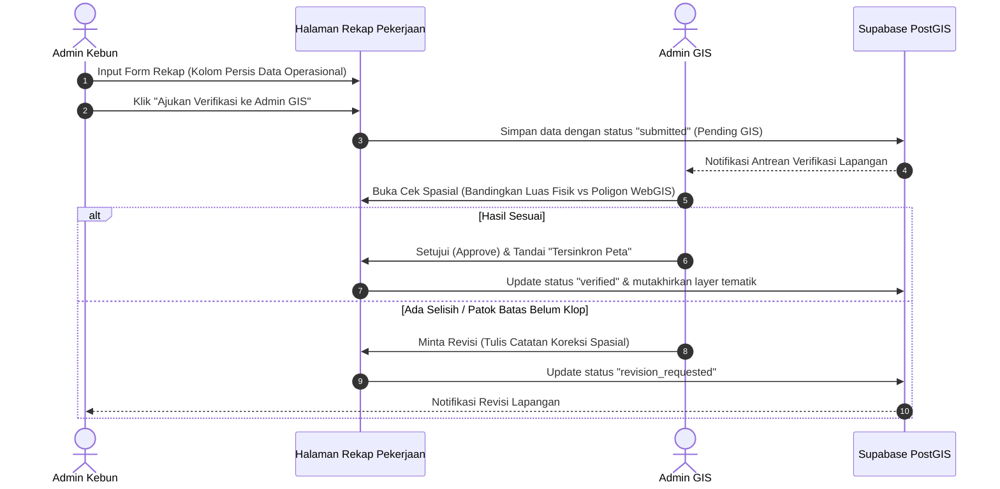

# RENCANA PENGEMBANGAN HALAMAN REKAP PEKERJAAN KEBUN (PEKERJAAN RUTIN & VERIFIKASI GIS)

> **Nomor Dokumen:** GIS-PLN-REKAP-2026-002  
> **Target Modul:** `frontend/web/src/pages/rekap-pekerjaan/pekerjaan-rutin/`  
> **Status:** Rencana Kerja Final (Diselaraskan dengan Skema Data Operasional)  
> **Tanggal Pembaruan:** 24 November 2026  
> **Pihak Terlibat:** Admin Kebun (Penginput Rekap Realisasi Fisik), Admin GIS (Verifikator Spasial & Pemutakhiran Peta)

---

## 1. TUJUAN & KONSEP UTAMA

Halaman ini berfungsi sebagai **portal input dan pengajuan verifikasi pekerjaan kebun harian/mingguan**:
1. **Admin Kebun** merekap pekerjaan rutin riil dari lapangan menggunakan **format kolom dan field yang persis sama dengan Data Operasional**.
2. Rekap yang diinput akan berstatus `Pengajuan Verifikasi` ke tim GIS.
3. **Admin GIS** memeriksa kesesuaian fisik terhadap poligon spasial (WebGIS/PostGIS), lalu memberikan status:
   - `Terverifikasi (Tersinkron)` $\rightarrow$ Otomatis masuk ke Master Data Operasional dan Peta Tematik.
   - `Revisi Diperlukan` $\rightarrow$ Catatan koreksi luas atau patok dikembalikan ke Admin Kebun.
   - `Ditolak` $\rightarrow$ Pekerjaan tidak valid / tumpang tindih.

---

## 2. SPESIFIKASI SKEMA KOLOM & FIELD (100% IDENTIK DENGAN DATA OPERASIONAL)

Struktur tabel data dan formulir modal input mengadopsi secara persis 16 kolom resmi Data Operasional kebun ditambah status verifikasi GIS:

| No | Nama Kolom / Field | Tipe Data | Deskripsi & Contoh Nilai |
|---|---|---|---|
| 1 | **Region** | String (Dropdown) | `REGION 1`, `REGION 2`, `REGION 3` |
| 2 | **Estate** | String (Dropdown) | `BUM 1` s.d. `BUM 8`, `BSL` (10 Estate resmi) |
| 3 | **Afdeling** | String (Dropdown) | `AFD 1` s.d. `AFD 35` (BUM) atau `AFD 1` s.d. `AFD 10` (BSL) |
| 4 | **Blok** | String (Dropdown) | Pilihan Blok baku: `A01`, `A02`, `B01`, `C05`, `D12`, dll. |
| 5 | **Warung** | String | Identitas Warung panen: `Warung 01`, `Warung 02`, dll. |
| 6 | **Luas (Ha)** | Number (Desimal) | Luas target / baku poligon blok (contoh: `30.0`) |
| 7 | **Realisasi Luas (Ha)**| Number (Desimal) | Realisasi fisik riil yang dikerjakan kebun (contoh: `25.5`) |
| 8 | **Capaian (%)** | Number (Formula) | Dihitung otomatis: `(Realisasi Luas / Luas) * 100` |
| 9 | **SPH** | Number (Integer) | Standar Pokok per Hektar (contoh: `136`) |
| 10 | **Kondisi** | String (Dropdown) | Dinamis sesuai jenis pekerjaan: `BAPP`, `Ringan`, `Sedang`, `Berat`, `Rotasi 1`, `Rotasi 2`, `Rotasi 3` |
| 11 | **Kontraktor** | String (Text) | Nama Mandor / CV Pelaksana (contoh: `CV Makmur Tani`, `Mandor Suwarno`) |
| 12 | **Update Peta** | String (Status) | `Belum Verifikasi`, `Proses Verifikasi GIS`, `Tersinkron (Valid)` |
| 13 | **Periode** | String (Month/Year) | Periode kerja (contoh: `2026-02`, `2026-03`) |
| 14 | **Tanggal** | Date (Native HTML5)| Tanggal riil pengerjaan di lapangan (contoh: `2026-02-24`) |
| 15 | **Keterangan** | Text (Area) | Catatan pekerjaan mandor / instruksi teknis lapangan |
| 16 | **Aktivitas** | String (Tab filter)| `pruning`, `semprot`, `pemupukan`, `pasar_pikul`, `jangkos` |
| 17 | **Status Verifikasi GIS**| Badge Status | `Diajukan` (Pending), `Diproses GIS`, `Terverifikasi`, `Revisi` |

---

## 3. ALUR VERIFIKASI DARI KEBUN KE GIS



---

## 4. TAMPILAN ANTARMUKA PENGGUNA (UI/UX RESMI TAILADMIN)

Tampilan disusun agar **familiar, bersih, dan seragam** dengan modul Data Operasional yang sudah ada:

### 4.1 Filter Baris Atas & Tab Pekerjaan
- **Tab Aktivitas**: `Semua`, `Pruning`, `Pemupukan`, `Pasar Pikul`, `Jangkos`, `Semprot`.
- **Toolbar Filter**:
  - Filter Tahun (`2026`, `2025`, `2024`)
  - Filter Region (`REGION 1`, `REGION 2`, `REGION 3`)
  - Filter Estate (`BUM 1` s.d. `BUM 8`, `BSL`)
  - Filter Afdeling (`AFD 1` s.d. `AFD 35`)
  - Filter Blok (Dropdown)
  - Input Pencarian: `"Cari blok, mandor, keterangan..."`
- **Tombol Aksi Utama**:
  - `+ Rekap Pekerjaan Baru` (Membuka dialog modal)
  - `Ajukan Verifikasi Masal` (Kirim batch data terpilih ke GIS)
  - `Export Excel/CSV`

### 4.2 Modal Dialog "Rekap Pekerjaan Baru" (`@/components/ui/dialog`)
Form modal disusun terstruktur persis dengan dialog input Data Operasional:
1. **Identitas Wilayah**: Region $\rightarrow$ Estate $\rightarrow$ Afdeling $\rightarrow$ Blok (Dropdown) $\rightarrow$ Warung.
2. **Data Fisik**: Luas (Ha), Realisasi Luas (Ha), SPH, Tanggal Kerja (Kalender Native), Periode.
3. **Agronomi & Pelaksana**: Jenis Aktivitas, Kondisi / Rotasi, Nama Kontraktor / Mandor.
4. **Keterangan & Lampiran**: Catatan kendala lapangan dan upload sketsa/foto acuan.

### 4.3 Modal Dialog "Verifikasi GIS" (Khusus Admin GIS)
- Menampilkan perbandingan:
  - **Luas Klaim Kebun**: `25.5 Ha`
  - **Luas Spasial Poligon GIS**: `25.3 Ha` (Selisih: `-0.2 Ha`)
- Pilihan Keputusan:
  - `Terverifikasi (Peta Diupdate)`
  - `Minta Revisi Lapangan`
  - `Tolak`
- Form Catatan Verifikator GIS & Unggah PDF Peta Validasi.

---

## 5. RENCANA FILE & STRUKTUR KODE

File akan dibuat di direktori: `frontend/web/src/pages/rekap-pekerjaan/pekerjaan-rutin/`
```
frontend/web/src/pages/rekap-pekerjaan/pekerjaan-rutin/
├── index.tsx                         # Halaman Utama Rekap Pekerjaan Rutin
├── types.ts                          # Tipe data identik OperasionalRecord + Status Verifikasi
├── mock-rekap-operasional.ts         # Data awal simulasi kebun
└── components/
    ├── rekap-stats.tsx               # Kartu ringkasan capaian & status verifikasi
    ├── rekap-toolbar.tsx             # Filter Region, Estate, AFD, Blok, Pencarian
    ├── rekap-table.tsx               # Tabel 16 kolom + kolom status verifikasi
    ├── rekap-form-modal.tsx          # Dialog input rekap identik form operasional
    └── rekap-verify-modal.tsx        # Dialog approval/revisi khusus Admin GIS
```

Rute di `App.tsx`:
- `/rekap-pekerjaan/pekerjaan-rutin`
- Sub-rute: `/rekap-pekerjaan/pekerjaan-rutin/:aktivitas` (`pruning`, `pemupukan`, dll)

---

## 6. LANGKAH IMPLEMENTASI SELANJUTNYA

1. **Langkah 1**: Menyiapkan file `types.ts` dan `mock-rekap-operasional.ts` dengan kolom yang 100% sama dengan `data-operasional`.
2. **Langkah 2**: Membangun dialog modal form rekap (`rekap-form-modal.tsx`) dan modal verifikasi GIS (`rekap-verify-modal.tsx`).
3. **Langkah 3**: Menyusun tabel data (`rekap-table.tsx`) lengkap dengan indikator progres capaian persen dan badge verifikasi.
4. **Langkah 4**: Menghubungkan halaman utama di `index.tsx` dan mendaftarkan rute di `App.tsx`.
5. **Langkah 5**: Menjalankan build `npm run build` untuk memverifikasi kelengkapan kode bebas error.
