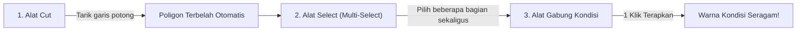

# 📘 PANDUAN LENGKAP & CATATAN PENGGUNAAN GIS STUDIO
**Sistem Informasi Geografis & Editor Spasial Perkebunan (GIS Studio)**  
*Dokumentasi Resmi Alur Kerja, Filosofi Desain, dan Panduan Operator*

---

## 1. Filosofi & Pemisahan Peran (HO / Kantor vs Kebun Lapangan)

Sistem GIS dirancang dengan pembagian tanggung jawab yang tegas agar alur data tertib dan tidak membingungkan:

### A. Admin HO / Kantor (Pengguna GIS Studio & Operasional)
* **Fokus Utama:**
  * Pengelolaan **Geometri & Delineasi Spasial** (pembagian blok, batas afdeling, pemetaan ancak kerja).
  * Pengawasan **Luas Lahan Baku (Hektar)** dan **Luas Realisasi**.
  * Pemantauan **Kondisi & Status Progres** (Produksi/Panen, Pruning, Pemupukan, Jangkos, Semprot).
* **Mengapa SPH Tidak Diinput di GIS Studio?**
  * SPH (Standar Pokok per Hektar) sangat dipengaruhi oleh kondisi riil di lapangan (topografi terjal, lereng curam, kontur terasering, kantong rawa, dan sisipan).
  * Mengharuskan Admin HO mengisi SPH di GIS Studio akan memperlambat proses editing peta dan rentan salah hitung.

### B. Admin / Tim Agronomi Kebun (Halaman Verifikasi Data Kebun)
* **Fokus Utama:**
  * Melakukan verifikasi data sensus lapangan hasil survei GPS langsung.
  * Menyesuaikan data **SPH riil**, jumlah pohon hidup/mati, dan jarak tanam per blok sesuai topografi.
  * Hasil verifikasi kebun otomatis menjadi referensi perhitungan taksasi di tingkat HO.

---

## 2. Alur Kerja Alat Utama (*Tool Workflow*)

### 1. Alat `Select` (Pilih & Multi-Select)
* **Fungsi:** Memilih satu atau banyak poligon sekaligus pada peta.
* **Cara Penggunaan:**
  * Klik poligon pertama untuk memilih.
  * Klik poligon lain untuk menambahkannya ke dalam seleksi (*toggle selection*).
  * Poligon terpilih akan memiliki garis tepi menyala (*glow border*).
* **Panel Samping Menampilkan:**
  * Total jumlah blok yang sedang dipilih.
  * Total luasan kumulatif (contoh: `Σ 84.5 Ha`).
  * Tombol cepat **"⚡ Lanjut Gabung Kondisi"** (langsung membawa poligon terpilih ke alat Gabung Kondisi tanpa perlu klik ulang dari awal).

### 2. Alat `Cut` (Potong / Bagi Wilayah Spasial)
* **Fungsi:** Membelah geometri poligon menjadi sub-bagian secara instan dan bersih.
* **Fitur Utama:**
  * **Fokus Murni Geometri:** Tidak ada pop-up kondisi yang mengganggu di tengah proses potong.
  * **Multi-Polygon Cut:** Jika garis potong melintasi 2 blok atau lebih, seluruh blok yang dilintasi otomatis terpotong menjadi bagian masing-masing.
  * **Integritas Master Data:** Master data di tabel **TIDAK TERGANGGU** (tidak menambah baris fiktif Blok A/B di tabel utama). Pemotongan hanya hidup di layer spasial visual.
* **Cara Penggunaan:**
  * Klik titik awal garis potong (bisa memanfaatkan magnet Snapping ke batas blok).
  * Tarik garis lurus melintasi poligon yang ingin dibagi.
  * **Klik Ganda (Double Click)** atau tekan **`Enter` / `Shift`** untuk menyelesaikan potongan seketika!

### 3. Alat `Merge` (Gabung Kondisi)
* **Fungsi:** Menyeragamkan warna dan status kondisi dari beberapa poligon terpilih **tanpa melebur batas geometrinya**.
* **Keunggulan:** Batas kepemilikan blok fisik tetap terjaga 100%, namun warna status operasionalnya seragam (misal: semuanya hijau/selesai panen).

### 4. Alat `Edit Atribut`
* **Fungsi:** Mengubah informasi pokok blok untuk kebutuhan pelaporan HO:
  * Kode Blok & Nama Poligon
  * Luas Lahan (Ha)
  * Kondisi Aktivitas (menyesuaikan modul: Produksi, Pruning, Jangkos, dll.)
  * Catatan Lapangan / Keterangan khusus.

### 5. Alat `Measure` (Pengukur Spasial)
* **Fungsi:** 
  * Mengukur jarak garis jalan/batas dalam satuan **meter (m)** dan **Kilometer (Km)**.
  * Menghitung luasan bidang dalam satuan **Hektar (Ha)** dan **meter persegi (m²)**.
  * Menyajikan daftar koordinat titik (Lat/Lng) yang dapat dihapus per titik.

---

## 3. Memahami Fitur "SNAP" (Magnet Kursor)

> 💡 **Prinsip Dasar:**  
> **Snap BUKAN untuk menyembunyikan garis batas peta.**  
> Garis batas blok dan afdeling akan selalu tampak sebagai peta dasar.  
> **Snap adalah fitur MAGNET PEREKAT KURSOR.**

* **Mengapa Harus Dinyalakan?**
  * Tangan manusia memiliki batas presisi saat mengklik mouse.
  * Jika Snap aktif: saat kursor didekatkan ke tepi Batas Blok, Batas Afdeling, atau Titik TPH (radius beberapa piksel), kursor akan **terkunci otomatis tepat di atas garis batas**.
  * Hasil potongan atau pengukuran dijamin **100% presisi tanpa celah kosong (*no gaps*) dan tanpa tumpang tindih (*no overlaps*)**.
* **Hierarki Garis Snapping:**
  1. **Batas Blok:** Garis hitam tipis (1.5px).
  2. **Batas Afdeling:** Garis hitam putus-putus (*dashed line*).
  3. **Batas Estate:** Garis hitam tebal (5.5px).
  4. **Titik TPH:** Titik koordinat tempat pengumpulan hasil panen (📍).

---

## 4. Keamanan Multi-User (Dua Admin Mengedit Bersamaan)

* **Apakah Aman Jika 2 Admin Mengedit Bersamaan?**
  * **SANGAT AMAN**, selama **Afdeling atau Blok yang diedit berbeda**.
  * Sistem penyimpanan database berbasis baris (*row-level transaction*). Perubahan pada Afdeling 1 disimpan terpisah dari perubahan pada Afdeling 2.
* **Pencegahan Konflik Blok yang Sama:**
  * Di masa depan, sistem dapat menampilkan indikator status *Locking* (Gembok) jika ada blok yang sedang dalam sesi editing oleh pengguna lain.

---

## 5. Daftar Lengkap Shortcut Keyboard (Pintasan Cepat)

Untuk mempercepat produktivitas operator GIS layaknya software profesional (AutoCAD/ArcGIS/QGIS):

| Shortcut | Aksi / Alat | Keterangan |
|---|---|---|
| **`S`** | **Alat Select** | Mode pilih & multi-select poligon |
| **`C`** | **Alat Cut** | Mode memotong poligon |
| **`M`** | **Alat Merge** | Mode gabung kondisi |
| **`A`** | **Alat Edit Atribut** | Mode form atribut blok |
| **`R`** | **Alat Measure** | Mode ukur jarak & luasan (*Ruler*) |
| **Klik Ganda (Double Click)** | **Selesai Cut** | Mengakhiri garis potong & memotong seketika |
| **`Enter` / `Shift`** | **Simpan Garis Potong** | Konfirmasi akhir garis pemotong |
| **`Esc` (Escape)** | **Batal Garis / Reset** | Membatalkan titik penarikan garis aktif |
| **`Ctrl + Z`** | **Undo** | Membatalkan langkah edit spasial terakhir |
| **`Ctrl + Y`** | **Redo** | Mengulangi langkah yang dibatalkan |
| **`Ctrl + S`** | **Simpan Perubahan** | Menyimpan sesi edit ke sistem |

---

## 6. Struktur Halaman & Modul Verifikasi Data Kebun

Sesuai standardisasi operasional, modul **Verifikasi Data Kebun** distrukturkan menjadi 4 pilar utama ditambah rekapitulasi:

1. **Rekap Pekerjaan** (`/verifikasi-data-kebun/rekap-pekerjaan`):
   * Ringkasan KPI dan status verifikasi lapangan kebun.
2. **Pekerjaan Rutin** (`/verifikasi-data-kebun/pekerjaan-rutin`):
   * Pruning
   * Pemupukan
   * Pasar Pikul
   * Jangkos
   * Semprot
3. **Persiapan Lahan** (`/verifikasi-data-kebun/persiapan-lahan`):
   * GRTT
   * Land Clearing
   * Tanam
4. **Update Aresta** (`/verifikasi-data-kebun/update-aresta`):
   * Sensus Pokok
   * Sisipan
   * Perubahan Blok
5. **Infrastruktur** (`/verifikasi-data-kebun/infrastruktur`):
   * Jalan
   * Jembatan & Gorong-gorong
   * Parit & Drainase
   * Titik TPH

---
*Dokumen ini dibuat secara otomatis dan menjadi panduan baku operasional GIS Studio Departemen GIS.*
