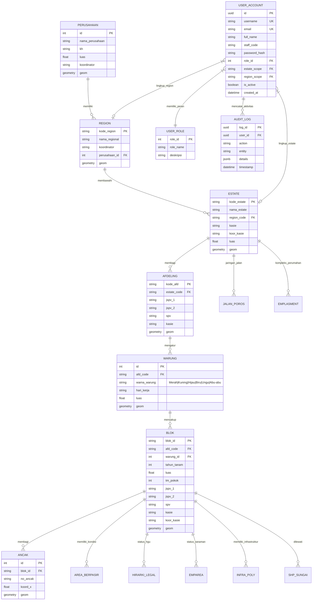

# RENCANA PENGEMBANGAN DATABASE RELASIONAL, ERD, RBAC, DAN DEPLOYMENT SISTEM GIS DEPARTEMEN

> **Nomor Dokumen:** GIS-PLN-2026-001  
> **Status Dokumen:** Usulan Final / Siap Eksekusi  
> **Tanggal Pembaruan:** 24 November 2026  
> **Departemen:** Geographic Information System (GIS) PT BUM & BSL  
> **Target Database:** Supabase (`https://fgczcppoaeojaqliudol.supabase.co`)  
> **Target Repositori:** GitHub (`https://github.com/databasegis2026-lgtm/GIS-Departemen.git`)

---

## 1. PENDAHULUAN & RUANG LINGKUP

Dokumen rencana kerja ini disusun untuk menetapkan fondasi arsitektur data geospasial, model data relasional (Entity Relationship Diagram - ERD), standarisasi skema 17 tabel atribut shapefile spasial dengan pembatas pipa (`|`), matriks hak akses 6-level pengguna (*Role-Based Access Control* / RBAC), integrasi database Supabase (PostgreSQL + PostGIS), serta alur otomatisasi *deployment* ke repositori GitHub.

### 1.1 Hierarki Operasional Kebun Terbaru
Struktur kepemilikan dan unit kelola operasional perkebunan:
```
Perusahaan (PT BUM & PT BSL)
   └── Region (Region 1, Region 2, Region 3 + BSL)
         └── Estate (BUM 1 s.d. BUM 8, BSL 1 - BSL 2 [Total 10 Estate])
               └── Afdeling (BUM: 35 AFD, BSL: 10 AFD [Total 45 AFD])
                     └── Warung (6 Zona Pengaturan Panen: Merah, Kuning, Hijau, Biru, Ungu, Abu-abu)
                           └── Blok (Blok Tanam & Luasan TM/TBM)
                                 └── Ancak (Unit Baris Panen & Pemeliharaan Karyawan)
```

---

## 2. KAMUS DATA SKEMA 17 TABEL ATRIBUT SPASIAL (PEMBATAS PIPA `|`)

Berikut adalah spesifikasi persis kolom untuk ke-17 layer master geospasial yang dihubungkan ke dalam database PostGIS:

### 2.1 Layer Batas & Administrasi
1. **Kolom Batas Perusahaan**
   `Region | REGIONAL | Koordinator | Luas | KH | Perusahaan | Id`
2. **Kolom Batas Estate (Struktur 1)**
   `Region | Estate | Luas | Kasie`
3. **Kolom Batas Estate (Struktur 2 - Manajerial)**
   `Region | REGIONAL | KOOR_KASIE`
4. **Kolom Batas AFD**
   `Region | Estate | JSPV_1 | JSPV_2 | SPV | KASIE | AFD`

### 2.2 Layer Blok, Warung, dan Namun Panen
5. **Kolom Batas BLOK**
   `Region | Estate | Afdeling | Blok | TahunTanam | Luas | TM_Pokok | JSPV_1 | JSPV_2 | SPV | KASIE | KOOR_KASIE | AFD`
6. **Kolom Warung**
   `BLOK | AFD | ESTATE | REGION | luas | WARUNG | HARI | Drive_Wafd`
7. **Kolom Ancak**
   `BLOK | AFD | ESTATE | REGION | luas | WARUNG | HARI | Drive_Wafd | BLOK_1 | AFD_1 | ESTATE_1 | REGION_1 | WARUNG_1 | HARI_1 | No_Ancak | Koord_X`
8. **Kolom Area Berpasir**
   `OBJECTID_1 | OBJECTID | REGION | AFD | ESTATE | Blok | WARUNG | CC | Luas | Shape_Leng | INSIDE_ | INSIDE_Y | INSIDE_Z | INSIDE_M | EXT_MIN_X | EXT_MIN_Y | EXT_MAX_X | EXT_MAX_Y | Koor_X | Koor_Y | Shape_Le_1 | Shape_Area`

### 2.3 Layer Legalitas, Tata Ruang & Hirarki Kebun
9. **Kolom Hirarki Update PT BUM**
   `BLOK | AFD | ESTATE | REGION | TH_TANAM | HGU | HRK_JENIS | HRK_KLOMPK | HRK_DETAL | No_HGU | ST_HGU | TALIASIH | Poten_HCV | KOP_PLASMA | KET_TA | Luas`
10. **Kolom Emparea**
    `OBJECTID | BLOK | AFD | ESTATE | REGION | TH_TANAM | POKOK | SPH | KETERANGAN | STATUS | HGU | LUA | SPH_AKTUAL | LU | INFO`
11. **Kolom Infra Poly**
    `OBJECTID | BLOK | AFD | ESTATE | REGION | TH_TANAM | POKOK | SPH | KETERANGAN | STATUS | HGU | LUA | SPH_AKTUAL | LU | INFO`

### 2.4 Layer Fasilitas, Bangunan & Jalan
12. **Kolom Emplasment**
    `X_UTM | Y_UTM | X_GEO | Y_GEO | DEPARTMENT | DIVISIONCO | GROUPLOCAT | BLOCKID | LOCATIONCO | LOCATIONNA | KETERANGAN | ESTATE | STT | EST | Luas`
13. **Kolom Implaments 1**
    `Region | Estate | Afdeling | Blok | LOCATIONNA | Ket2`
14. **Kolom Jalan Poros**
    `Id | Keterangan | Panjang | Estate | Keterang_1 | AFD | BEARING | LENGTH`

### 2.5 Layer Hidrologi & Topografi
15. **Kolom SHP Sungai**
    `BLOK | AFD | ESTATE | REGION | KETERANGAN`
16. **Kolom Nama Sungai**
    `NAME | LAYER | KML_STYLE | KML_FOLDER | TimeStamp`
17. **Kolom Kontur**
    `OBJECTID | Contour | Shape_Leng`

---

## 3. ENTITY RELATIONSHIP DIAGRAM (ERD) & ARSITEKTUR DATABASE

Arsitektur database dirancang pada platform PostgreSQL/PostGIS di Supabase, mengintegrasikan data master spasial, data operasional harian, dan tabel sistem keamanan/RBAC.



---

## 4. MATRIKS HAK AKSES (RBAC) 6 TINGKAT PENGGUNA

Sistem menerapkan pembatasan hak akses bertingkat berbasis peran (*Role-Based Access Control* / RBAC) dengan kredensial bawaan (*default credentials*) yang mudah dikelola:

| No | Tingkatan Pengguna | Pemegang Akun / Daftar Akun | Lingkup Data Spasial & Operasional | Password Bawaan | Halaman yang Disembunyikan / Tidak Bisa Diakses |
|---|---|---|---|---|---|
| **1** | **Superadmin** | Ari Setyo Wibowo (Manager GIS) | **Global Penuh** (Audit Aktivitas, Tambah Akun, Nonaktifkan Akun) | `admin12345` | • Preferensi GIS<br>• Zona Bahaya |
| **2** | **Admin GIS** | • Agus Adi Permana (Kode G)<br>• Bagja Arya Wiguna (Kode E)<br>• Reki Hamdani (Kode F)<br>• Iqbal Tri Junaidy (Kode B)<br>• Widodo Arif Rohman (Kode C) | **Global GIS Operasional** (Editing Spasial, Cetak Peta, Export, Master Data) | `admin12345` | • Audit Aktivitas<br>• Kelola & Tambah Akun<br>• Preferensi GIS<br>• Zona Bahaya |
| **3** | **User Estate** | 9 Akun:<br>• `estate_bum1`<br>• `estate_bum2`<br>• `estate_bum3`<br>• `estate_bum4`<br>• `estate_bum5`<br>• `estate_bum6`<br>• `estate_bum7`<br>• `estate_bum8`<br>• `estate_bsl` | **Hanya Estate yang Dikelola** (Filter ketat di layer peta dan data tabel) | `user12345` | • Rekap Pekerjaan<br>• Data Operasional<br>• Rekap Pekerjaan Kebun<br>• Persiapan Lahan<br>• Aset<br>• Audit Aktivitas<br>• Kelola & Tambah Akun<br>• Keamanan Sandi<br>• Preferensi GIS<br>• Zona Bahaya |
| **4** | **User Admin Kebun** | 3 Akun:<br>• `adminkebun_r1` (BUM 1, 2, 4)<br>• `adminkebun_r2` (BUM 5, 6, 7)<br>• `adminkebun_r3` (BUM 3, 8, BSL) | **Hanya Region yang Dikelola** (Mencakup seluruh estate di region terkait) | `user12345` | • Audit Aktivitas<br>• Kelola & Tambah Akun<br>• Keamanan Sandi<br>• Preferensi GIS<br>• Zona Bahaya |
| **5** | **User Regional HO** | 3 Akun:<br>• `koor_reg1`<br>• `koor_reg2`<br>• `koor_reg3_bsl` | **Hanya Region yang Dikelola** (Monitoring agregat eksekutif regional) | `user12345` | • Audit Aktivitas<br>• Kelola & Tambah Akun<br>• Preferensi GIS<br>• Zona Bahaya |
| **6** | **User Global** | • `user_global` | **Seluruh Perusahaan (Global Read-Only)** | `user12345` | • Audit Aktivitas<br>• Kelola & Tambah Akun<br>• Preferensi GIS<br>• Zona Bahaya |

---

## 5. STRATEGI INTEGRASI SUPABASE POSTGIS & SECURITY

- **Project URL:** `https://fgczcppoaeojaqliudol.supabase.co`
- **Konfigurasi Ekstensi:** Aktifkan ekstensi `postgis` pada skema `public`:
  ```sql
  CREATE EXTENSION IF NOT EXISTS postgis;
  ```
- **Row Level Security (RLS) Policies:**
  Penerapan kebijakan keamanan data pada tabel operasional dan spasial berdasarkan token JWT sesi pengguna:
  ```sql
  -- Contoh Kebijakan RLS untuk User Estate
  CREATE POLICY "estate_isolation_policy" ON "public"."blok_master"
  FOR SELECT
  USING (
    auth.jwt() ->> 'role' = 'superadmin' 
    OR auth.jwt() ->> 'role' = 'admin_gis'
    OR auth.jwt() ->> 'role' = 'user_global'
    OR (auth.jwt() ->> 'role' = 'user_estate' AND estate_code = (auth.jwt() ->> 'estate_scope'))
    OR (auth.jwt() ->> 'role' IN ('admin_kebun', 'regional_ho') AND region_code = (auth.jwt() ->> 'region_scope'))
  );
  ```

---

## 6. STRATEGI DEPLOYMENT GITHUB

- **Repositori Target:** `https://github.com/databasegis2026-lgtm/GIS-Departemen.git`
- **Langkah-langkah Eksekusi Git:**
  1. Membersihkan artefak *build* sementara (`node_modules`, dist, cache).
  2. Memverifikasi `.gitignore` agar file kredensial sensitif (`.env.local`, file pribadi) tidak bocor.
  3. Konfigurasi remote Git:
     ```powershell
     git remote set-url origin https://github.com/databasegis2026-lgtm/GIS-Departemen.git
     ```
  4. Pembuatan *commit* bersih yang menyertakan modul dashboard terbaru, dokumentasi, skema PostGIS, dan RBAC router.
  5. *Push* ke branch utama (`main`):
     ```powershell
     git branch -M main
     git push -u origin main
     ```

---

## 7. RENCANA TAHAPAN EKSEKUSI (ROADMAP)

1. **Fase 1: Pembuatan Skrip Migrasi SQL PostGIS**
   - Membuat file `supabase_schema_master.sql` yang memuat tabel 17 layer master spasial, indeks geospasial `GIST(geom)`, tabel autentikasi pengguna, dan *seed data* akun bawaan.
2. **Fase 2: Implementasi State & Router Guard RBAC Frontend**
   - Menambahkan context otentikasi pengguna (`AuthContext`), penyaringan menu *Sidebar* dinamis sesuai tabel hak akses di Bab 4, serta pembatasan rute (*Protected Routes*).
3. **Fase 3: Penyaringan Data Spasial & Peta Berdasarkan Scope Pengguna**
   - Menyambungkan filter dinamis pada layer Mapbox/Leaflet agar pengguna tingkat Estate dan Region otomatis menerima *bounding box* dan query data yang sesuai haknya.
4. **Fase 4: Push ke GitHub & Verifikasi Produksi**
   - Melakukan penyiapan repositori git dan *push* ke repositori organisasi `GIS-Departemen.git`.
